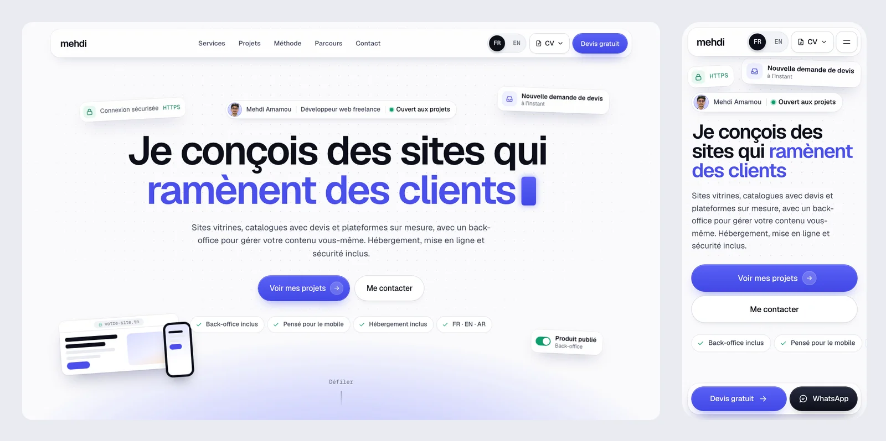

# Portfolio — Mehdi Amamou

Site one-page bilingue (français / anglais) de Mehdi Amamou, développeur web freelance et étudiant ingénieur en cybersécurité : services, projets avec galerie de captures, méthode, parcours et formulaire de contact.



**Site en ligne :** bientôt disponible.

## Stack

- [Next.js 16](https://nextjs.org) (App Router, TypeScript), pages statiques et build `standalone`
- [next-intl](https://next-intl.dev) : français par défaut, anglais sur `/en`
- [Motion](https://motion.dev) pour les animations, [GSAP](https://gsap.com) ScrollTrigger pour la timeline et l'horizon
- Formulaire : Server Action, [zod](https://zod.dev), [Nodemailer](https://nodemailer.com)
- CSS sur mesure en container queries, sans framework
- Tests : [Playwright](https://playwright.dev) et [axe](https://github.com/dequelabs/axe-core)

## Lancer en local

Prérequis : Node.js 20.9 ou plus.

```bash
npm install
npm run dev     # http://localhost:3000
```

En développement, sans configuration SMTP, le formulaire simule l'envoi. Pour la production, copier `.env.example` en `.env` et le remplir.

```bash
npm run build   # build standalone
npm start       # http://localhost:3000
npx playwright install chromium && npm test
```

## Contenu

| Quoi | Où |
|---|---|
| Captures des projets (toutes affichées, triées par nom, `01` en vignette) | `assets/projects/<projet>/` |
| Photo | `assets/photos/` |
| Projets, liens, mise en ligne (`live`) | `src/content/projects.json` |
| Textes FR / EN | `messages/fr.json`, `messages/en.json` |

La mise en ligne sur un VPS (PM2, Nginx, Let's Encrypt) est décrite dans [`deploy/MISE-EN-LIGNE.md`](deploy/MISE-EN-LIGNE.md).

## Licence

Le code est sous licence [MIT](LICENSE). La photo, les captures des projets clients, les textes et la maquette (`design/`) ne sont pas couverts par cette licence et restent la propriété de leurs auteurs.
